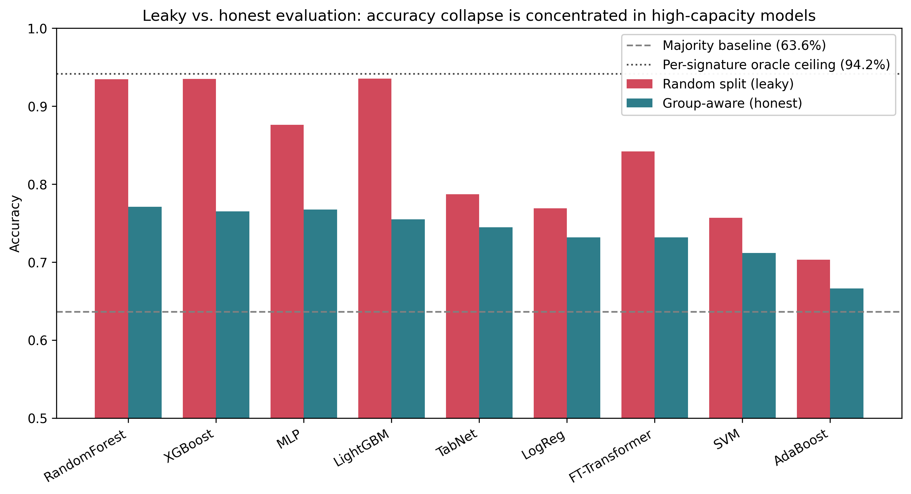
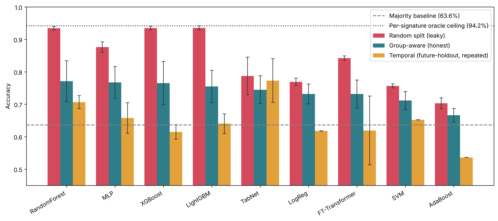
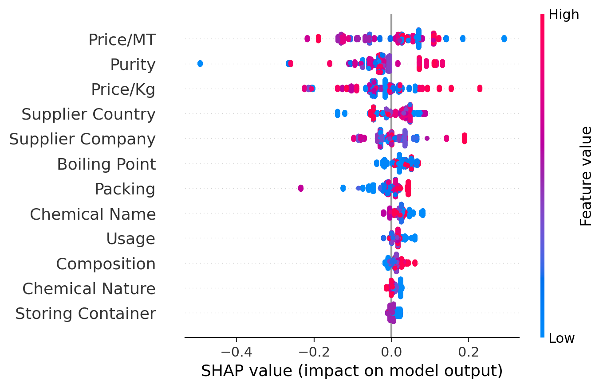

# Duplicate Feature Signatures Inflate Tabular Model Accuracy

A leakage-aware re-benchmark of nine tabular ML models on a real industrial quality-prediction dataset, showing that a standard random train/test split silently leaks 97.5% of the data through duplicate feature signatures — and that fixing this **reorders which model looks best**.

[](https://colab.research.google.com/github/Al-AminKhan043/leakage-aware-tabular-benchmark/blob/main/notebooks/01_leakage_diagnosis.ipynb)
[](https://colab.research.google.com/github/Al-AminKhan043/leakage-aware-tabular-benchmark/blob/main/notebooks/02_benchmark.ipynb)
[](https://colab.research.google.com/github/Al-AminKhan043/leakage-aware-tabular-benchmark/blob/main/notebooks/03_camera_ready_analysis.ipynb)
[](LICENSE)

> **Paper status:** Accepted for **oral presentation** at [ICCIT 2026](https://iccit.org.bd/2026/) (29th International Conference on Computer and Information Technology, Cox's Bazar, Bangladesh, 18–20 December 2026). To appear in IEEE Xplore.

---

## The problem

Random train/test splitting is the default evaluation protocol in applied tabular ML — but it silently fails when a dataset contains many duplicate feature vectors. In a real industrial textile-chemical quality dataset (9,310 records, 12 features, binary Good/Bad target), **97.5% of records collapse onto only 235 unique feature signatures** once the date column is removed. Under a standard random split, **99.96% of test records have an exact feature twin in training**, and high-capacity models reach 93–94% accuracy — largely by memorizing duplicated signatures rather than generalizing.

Re-evaluating the same nine models under **signature-grouped cross-validation** drops accuracy to roughly 66–77% (Wilcoxon signed-rank across models, p = 0.004) and reorders the model ranking. A **repeated temporal** (train-past / test-future) protocol lowers it further and shows that single-run results for deep tabular models can move by more than ten accuracy points across seeds.

## Key result

Leaky (random split) vs. honest (signature-grouped CV) accuracy, mean ± s.d. over five folds, sorted by honest macro-F1:

| Model | Leaky Acc. | Honest Acc. | Honest F1 | Acc. Drop |
|---|---|---|---|---|
| RandomForest | 0.934 ± 0.006 | 0.771 ± 0.063 | 0.740 | 0.163 |
| XGBoost | 0.935 ± 0.005 | 0.765 ± 0.067 | 0.737 | 0.170 |
| MLP | 0.876 ± 0.016 | 0.768 ± 0.049 | 0.724 | 0.109 |
| LightGBM | 0.936 ± 0.006 | 0.755 ± 0.050 | 0.714 | 0.181 |
| TabNet | 0.787 ± 0.058 | 0.745 ± 0.043 | 0.697 | 0.042 |
| LogReg | 0.769 ± 0.011 | 0.732 ± 0.030 | 0.650 | 0.037 |
| FT-Transformer | 0.842 ± 0.007 | 0.732 ± 0.043 | 0.644 | 0.111 |
| SVM | 0.757 ± 0.007 | 0.712 ± 0.028 | 0.611 | 0.045 |
| AdaBoost | 0.703 ± 0.017 | 0.666 ± 0.021 | 0.537 | 0.037 |

Reference lines: majority-class baseline **63.6%**, per-signature oracle ceiling **94.2%**.

> *Mean accuracies are the output of `results/tables/final_benchmark.csv`, produced by running `02_benchmark.ipynb` end-to-end (all 9 models, `random_state=42`). They match Table II of the paper.*

The models that benefited most from leakage (LightGBM, XGBoost, RandomForest — losing 16–18 points once leakage is removed) are precisely the ones with the capacity to memorize duplicated feature signatures.

## Camera-ready additions

The camera-ready version adds the following analyses in response to reviewer comments. All of them are in [`notebooks/03_camera_ready_analysis.ipynb`](notebooks/03_camera_ready_analysis.ipynb); the classical-model numbers below are its actual output. The deep-model (TabNet, FT-Transformer) runs were made with [`analysis/analysis_deep.py`](analysis/analysis_deep.py) (AMD RX 9060 XT, ROCm, seeds 42/0/1/2/3); their raw per-run output is [`results/tables/deep_rows.csv`](results/tables/deep_rows.csv), which notebook 03 summarises.

**How much leaks.** Train–test signature overlap (share of test records whose exact signature also appears in training):

| Protocol | Overlap |
|---|---|
| Random 5-fold (leaky) | **99.96%** (min fold 99.89%) |
| Signature-grouped 5-fold (honest) | **0%** by construction |
| Temporal 80/20 (cut 26 May 2023) | **4.9%** |

**Duplication structure.** Records per signature: mean 39.6, median 31 (IQR 30–31), max 211; only four signatures occur once. Seventeen signatures (1,339 records) carry both labels, which caps the per-signature oracle at 94.2%.

**Repeated temporal evaluation.** The single 80/20 temporal split depends on how records that share a date are ordered, so it is repeated (classical models: 10 same-date orderings; deep models: 5 seeds). An expanding-window evaluation trains on the first 60/70/80/90% and tests on the next 10%. Sensitivity/specificity use **Bad** (the defect) as the positive class.

| Model | 80/20 Acc. | 80/20 F1 | Sens. | Spec. | Expanding F1 |
|---|---|---|---|---|---|
| TabNet | 0.773 ± 0.068 | 0.742 | 0.64 | 0.85 | 0.670 ± 0.136 |
| RandomForest | 0.707 ± 0.020 | 0.681 | 0.58 | 0.78 | 0.730 ± 0.072 |
| MLP | 0.658 ± 0.047 | 0.610 | 0.42 | 0.79 | 0.567 ± 0.120 |
| LightGBM | 0.640 ± 0.030 | 0.608 | 0.49 | 0.73 | 0.593 ± 0.093 |
| XGBoost | 0.615 ± 0.022 | 0.582 | 0.46 | 0.71 | 0.618 ± 0.098 |
| LogReg | 0.618 ± 0.000 | 0.499 | 0.18 | 0.87 | 0.566 ± 0.073 |
| FT-Transformer | 0.619 ± 0.106 | 0.477 | 0.15 | 0.89 | 0.608 ± 0.151 |
| SVM | 0.652 ± 0.000 | 0.470 | 0.09 | 0.98 | 0.543 ± 0.114 |
| AdaBoost | 0.536 ± 0.000 | 0.378 | 0.04 | 0.82 | 0.498 ± 0.045 |

**Statistical tests.**
- Wilcoxon signed-rank, paired across the nine models: leaky > honest (p = 0.004), honest > temporal (p = 0.008). Folds are not used as pairs because with five folds the test cannot reach p < 0.0625.
- Two-sided binomial test against the temporal test-period majority (63.5%): XGBoost (p = 0.010) and AdaBoost (p < 0.001) fall significantly *below* it; LightGBM, LogReg and SVM are indistinguishable from it (p ≥ 0.12); FT-Transformer's original single run (0.636) is indistinguishable from it (p = 0.98).
- Spearman rank correlation between protocol rankings: leaky–honest **ρ = 0.80**, honest–temporal **ρ = 0.48**, leaky–temporal **ρ = 0.20**.

**Reproducibility notes.** All models use library-default hyperparameters (no tuning), except RandomForest (300 trees), MLP (64, 32 hidden units), LogReg (max 1,000 iterations), and the deep models (100 epochs, batch size 256). Seed 42 throughout. The primary benchmark ran on an NVIDIA RTX 4060; the repeated temporal and class-wise analyses of the deep models ran on an AMD RX 9060 XT (ROCm). All classical results reproduced exactly across machines; the deep models' honest accuracy shifted by up to 0.07 across GPUs (e.g. TabNet 0.745 → 0.677), which is one reason the paper reports repeated runs.

## Figures

**Signature duplication diagnosis** — 9,310 rows collapse onto 235 unique signatures (97.5% duplication):


**Leaky vs. honest accuracy**, all 9 models:



**All three protocols (leaky / honest / repeated temporal)**, with ±1 s.d. error bars over folds (leaky, honest) or repeated runs (temporal):



**SHAP feature attribution** (honest-protocol Random Forest) — the model relies on genuine chemical/procurement signal, not identity leakage:



## Repository structure

```
.
├── data/
│   └── README.md               # data dictionary + availability note (raw data not included)
├── notebooks/
│   ├── 01_leakage_diagnosis.ipynb      # diagnoses leakage, builds thesis_clean.csv
│   ├── 02_benchmark.ipynb              # original benchmark (paper Table II), SHAP, figures
│   └── 03_camera_ready_analysis.ipynb  # overlap, sens/spec, repeated temporal, expanding window, tests, Fig. 3
├── analysis/
│   └── analysis_deep.py             # standalone script for the deep-model camera-ready runs (GPU)
├── results/
│   ├── tables/
│   │   ├── final_benchmark.csv      # leaky vs. honest, all 9 models
│   │   ├── temporal_benchmark.csv   # single-split temporal results
│   │   ├── cr_cv_folds.csv          # per-fold leaky/honest acc, F1, sens, spec (classical)
│   │   ├── cr_temporal_8020.csv     # temporal 80/20 with sens/spec + binomial test
│   │   ├── cr_temporal_repeated.csv # 10 same-date orderings
│   │   ├── cr_expanding.csv         # expanding-window runs
│   │   ├── cr_summary.csv           # all 9 models, three protocols, mean ± s.d.
│   │   └── deep_rows.csv            # every TabNet / FT-Transformer camera-ready run (GPU)
│   └── figures/
│       ├── leakage_diagnosis.png
│       ├── leaky_vs_honest.png
│       ├── three_protocol.png               # paper Fig. 3 (repeated temporal, error bars), from notebook 03
│       └── shap_summary.png
├── requirements.txt
└── LICENSE
```

**Raw data is not included** — see [`data/README.md`](data/README.md) for the schema and availability note. `final_benchmark.csv` is the complete, authoritative table for the leaky vs. honest comparison.

## Quickstart

> **Note:** raw data files are not in this repo (see [`data/README.md`](data/README.md)). To execute the notebooks, place your own copies of `thesis_dataset.csv` (and optionally `thesis_clean.csv`) into `data/` first — available on request from the author, subject to the firm's approval. Without them, the code is still fully readable for methodology review, but the cells won't run.

**Option A — Google Colab:**
Click an "Open in Colab" badge above, then upload `thesis_dataset.csv` into the Colab file browser under `data/` before running.

**Option B — Locally:**
```bash
git clone https://github.com/Al-AminKhan043/leakage-aware-tabular-benchmark.git
cd leakage-aware-tabular-benchmark
pip install -r requirements.txt
# place thesis_dataset.csv in data/ here
jupyter lab notebooks/01_leakage_diagnosis.ipynb
```

Run `01_leakage_diagnosis.ipynb` first — it produces `data/thesis_clean.csv` from the raw file. Then run `02_benchmark.ipynb`, and `03_camera_ready_analysis.ipynb` for the camera-ready analyses. In notebook 03 the classical models run on CPU in a few minutes; set `RUN_DEEP = True` on a GPU runtime to retrain the deep models too (otherwise it summarises the shipped `deep_rows.csv`). For the deep runs outside a notebook: `python analysis/analysis_deep.py data/thesis_clean.csv results/tables --seeds 42,0,1,2,3`.

**Note on hardware:** TabNet and FT-Transformer are each trained for 5 folds × 100 epochs; a GPU is strongly recommended (in Colab: `Runtime > Change runtime type > GPU`). The classical models run fine on CPU.

## Method summary

1. **Diagnose**: build a per-row *feature signature* (the exact combination of all 12 feature values, excluding `Date` and the target; numeric fields compared without rounding) and count duplicates.
2. **Leaky protocol**: standard `StratifiedKFold` — the default most practitioners use.
3. **Honest protocol**: `StratifiedGroupKFold` grouped by signature — guarantees zero signature overlap between train and test.
4. **Temporal protocol**: train on the earliest 80% by date, test on the latest 20%, repeated over same-date orderings (classical) or seeds (deep); plus an expanding-window evaluation.
5. Nine models are benchmarked identically under all protocols: Logistic Regression, SVM, AdaBoost, Random Forest, XGBoost, LightGBM, MLP, TabNet, and FT-Transformer.
6. Accuracy, macro-F1 and class-wise sensitivity/specificity are reported, with Wilcoxon, binomial and Spearman tests.
7. SHAP attribution on the honest-protocol Random Forest confirms the model relies on genuine chemical/procurement signal (purity, price, supplier) rather than identity leakage.

## Citation

If you use this work, please cite:

```bibtex
@inproceedings{khan2026leakage,
  author    = {Al Amin Khan},
  title     = {Duplicate Feature Signatures Inflate Tabular Model Accuracy:
               A Leakage-Aware Re-Benchmark on Industrial Quality Data},
  booktitle = {Proceedings of the 29th International Conference on Computer
               and Information Technology (ICCIT)},
  address   = {Cox's Bazar, Bangladesh},
  year      = {2026},
  note      = {Accepted, to appear in IEEE Xplore}
}
```

## Acknowledgment

Thanks to Md. Rashadur Rahman (Department of CSE, CUET) for supervising the undergraduate thesis from which this work developed.

## Author

**Md. Al Amin Khan** — B.Sc. Computer Science and Engineering, Chittagong University of Engineering and Technology (CUET)
[Portfolio](https://next-portfolio-two-lovat.vercel.app/) · [LinkedIn](https://linkedin.com/in/alaminkhan43) · [GitHub](https://github.com/Al-AminKhan043) · [alaminkhan10009@gmail.com](mailto:alaminkhan10009@gmail.com)

## License

Released under the [MIT License](LICENSE).
