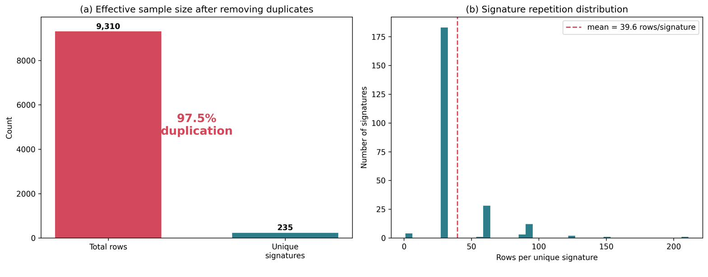

# Duplicate Feature Signatures Inflate Tabular Model Accuracy

A leakage-aware re-benchmark of nine tabular ML models on a real industrial quality-prediction dataset, showing that a standard random train/test split silently leaks 97.5% of the data through duplicate feature signatures — and that fixing this **reorders which model looks best**.

[](https://colab.research.google.com/github/Al-AminKhan043/leakage-aware-tabular-benchmark/blob/main/notebooks/01_leakage_diagnosis.ipynb)
[](https://colab.research.google.com/github/Al-AminKhan043/leakage-aware-tabular-benchmark/blob/main/notebooks/02_benchmark.ipynb)
[](LICENSE)

> **Paper status:** Submitted to [ICCIT 2026](https://iccit.org.bd/2026/) (29th International Conference on Computer and Information Technology, IEEE Bangladesh Section) — currently under review.

---

## The problem

Random train/test splitting is the default evaluation protocol in applied tabular ML — but it silently fails when a dataset contains many duplicate feature vectors. In a real industrial textile-chemical quality dataset (9,310 records, 12 features, binary Good/Bad target), **97.5% of records collapse onto only 235 unique feature signatures** once the date column is removed. Under a standard random split, high-capacity models reach 93–94% accuracy — largely by memorizing duplicated signatures rather than generalizing.

Re-evaluating the same nine models under a **signature-grouped cross-validation** protocol and a **temporal** (train-past / test-future) protocol drops honest accuracy to roughly 66–77% — and reorders the model ranking: the apparent lead of high-capacity models over a logistic-regression baseline collapses from 16 points to a few.

## Key result

Honest accuracy (signature-grouped CV) vs. leaky accuracy (random split), sorted by honest macro-F1:

| Model | Leaky Acc. | Honest Acc. | Honest F1 | Acc. Drop |
|---|---|---|---|---|
| RandomForest | 0.934 | 0.771 | 0.740 | 0.163 |
| XGBoost | 0.935 | 0.765 | 0.737 | 0.170 |
| MLP | 0.876 | 0.768 | 0.724 | 0.109 |
| LightGBM | 0.936 | 0.755 | 0.714 | 0.181 |
| TabNet | 0.787 | 0.745 | 0.697 | 0.042 |
| LogReg | 0.769 | 0.732 | 0.650 | 0.037 |
| FT-Transformer | 0.842 | 0.732 | 0.644 | 0.111 |
| SVM | 0.757 | 0.712 | 0.611 | 0.045 |
| AdaBoost | 0.703 | 0.666 | 0.537 | 0.037 |

Reference lines: majority-class baseline **63.6%**, per-signature oracle ceiling **94.2%**.

> *Numbers above are the actual output of `results/tables/final_benchmark.csv`, produced by running `02_benchmark.ipynb` end-to-end (all 9 models, `random_state=42`) — not copied from the paper. They match the paper's Table II.*

The models that benefited most from leakage (LightGBM, XGBoost, RandomForest — losing 16–18 points once leakage is removed) are precisely the ones with the capacity to memorize duplicated feature signatures.

## Figures

**Signature duplication diagnosis** — 9,310 rows collapse onto 235 unique signatures (97.5% duplication):



**Leaky vs. honest accuracy**, all 9 models:


**All three protocols (leaky / honest / temporal) side by side**, all 9 models:


**SHAP feature attribution** (honest-protocol Random Forest) — the model relies on genuine chemical/procurement signal, not identity leakage:


## Repository structure

```
.
├── data/
│   └── README.md               # data dictionary + availability note (raw data not included)
├── notebooks/
│   ├── 01_leakage_diagnosis.ipynb   # diagnoses leakage, builds thesis_clean.csv
│   └── 02_benchmark.ipynb           # honest / leaky / temporal benchmark, SHAP, figures
├── results/
│   ├── tables/
│   │   ├── final_benchmark.csv      # leaky vs. honest, all 9 models
│   │   └── temporal_benchmark.csv   # temporal-protocol results, all 9 models
│   └── figures/
│       ├── leakage_diagnosis.png
│       ├── leaky_vs_honest.png
│       ├── three_protocol.png
│       └── shap_summary.png
├── requirements.txt
└── LICENSE
```

**Raw data is not included** — see [`data/README.md`](data/README.md) for the schema and availability note. `results/tables/honest_benchmark.csv` and `leaky_vs_honest.csv` are additional intermediate checkpoints `02_benchmark.ipynb` writes along the way; `final_benchmark.csv` is the complete, authoritative table.

## Quickstart

> **Note:** raw data files are not in this repo (see [`data/README.md`](data/README.md)). To actually execute the notebooks, place your own copies of `thesis_dataset.csv` (and optionally `thesis_clean.csv`) into `data/` first — available on request from the author. Without them, the code is still fully readable for methodology review, but the cells won't run.

**Option A — Google Colab:**
Click an "Open in Colab" badge above, then upload `thesis_dataset.csv` into the Colab file browser under `data/` before running.

**Option B — Locally:**
```bash
git clone https://github.com/Al-AminKhan043/leakage-aware-tabular-benchmark.git
cd leakage-aware-tabular-benchmark
pip install -r requirements.txt
# place thesis_dataset.csv in data/ here
jupyter lab notebooks/01_leakage_diagnosis.ipynb
```

Run `01_leakage_diagnosis.ipynb` first — it produces `data/thesis_clean.csv` from the raw file. Then run `02_benchmark.ipynb`.

**Note on hardware:** TabNet and FT-Transformer are each trained for 5 folds × 100 epochs; a GPU is strongly recommended (in Colab: `Runtime > Change runtime type > GPU`). The classical models (LogReg, SVM, AdaBoost, RandomForest, XGBoost, LightGBM, MLP) run fine on CPU.

## Method summary

1. **Diagnose**: build a per-row *feature signature* (the exact combination of all feature values excluding `Date`) and count duplicates.
2. **Honest protocol**: `StratifiedGroupKFold` grouped by signature — guarantees zero signature overlap between train and test.
3. **Leaky protocol**: standard `StratifiedKFold` — the default most practitioners use.
4. **Temporal protocol**: train on the earliest 80% by date, test on the latest 20% — the deployment-realistic scenario.
5. Nine models are benchmarked identically under all three protocols: Logistic Regression, SVM, AdaBoost, Random Forest, XGBoost, LightGBM, MLP, TabNet, and FT-Transformer.
6. SHAP attribution on the honest-protocol Random Forest confirms the model relies on genuine chemical/procurement signal (purity, price, supplier) rather than identity leakage.

## Citation

The paper is currently under review at ICCIT 2026. A full citation will be added here once the camera-ready version is available. In the meantime:

```bibtex
@misc{khan2026leakage,
  author       = {Al Amin Khan},
  title        = {Duplicate Feature Signatures Inflate Tabular Model Accuracy:
                   A Leakage-Aware Re-Benchmark on Industrial Quality Data},
  howpublished = {Submitted to ICCIT 2026},
  year         = {2026}
}
```

## Author

**Md. Al Amin Khan** — B.Sc. Computer Science Engineering, Chittagong University of Engineering and Technology (CUET)
[Portfolio](https://next-portfolio-two-lovat.vercel.app/) · [LinkedIn](https://linkedin.com/in/alaminkhan43) · [GitHub](https://github.com/Al-AminKhan043) · [alaminkhan10009@gmail.com](mailto:alaminkhan10009@gmail.com)

## License

Released under the [MIT License](LICENSE).
